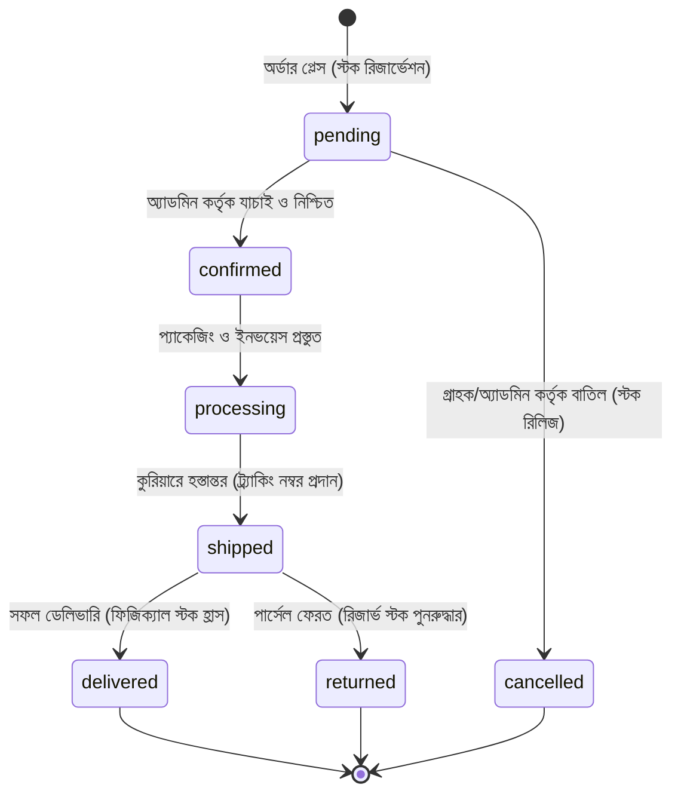

# লুমিনা লাগেজ — ই-কমার্স স্টোরফ্রন্ট ও অনলাইন অর্ডার আর্কিটেকচার (Phase 8 Documentation)

## ১. সারসংক্ষেপ ও উদ্দেশ্য
লুমিনা লাগেজ ও ব্যাগ শপ ম্যানেজমেন্ট সিস্টেমের ফেজ ৮-এ সম্পূর্ণ ডাটাবেস-সংযুক্ত, দৃষ্টিনন্দন এবং দ্রুতগতির বাংলা ই-কমার্স স্টোরফ্রন্ট এবং অনলাইন অর্ডার ম্যানেজমেন্ট ইঞ্জিন সফলভাবে নির্মিত হয়েছে। এই সিস্টেমের মূল লক্ষ্য হলো ফিজিক্যাল শপের POS ক্যাশ কাউন্টারের সাথে সেন্ট্রালাইজড ইনভেন্টরির শতভাগ নিখুঁত সমন্বয় রেখে অনলাইন বিক্রয় পরিচালনা করা, যাতে কোনো অবস্থাতেই দ্বৈত বুকিং বা অতিরিক্ত বিক্রয় (Overselling) না ঘটে।

---

## ২. অনলাইন অর্ডার লাইফসাইকেল ও স্টেট মেশিন (Order State Machine)

অনলাইন অর্ডারের সম্পূর্ণ জীবনচক্র সার্ভার-সাইডে সুরক্ষিতভাবে নিচের স্টেট ট্রানজিশনের মাধ্যমে নিয়ন্ত্রিত হয়:



### স্ট্যাটাস নির্দেশিকা:
1. **`pending` (অপেক্ষারত)**: অর্ডার সফলভাবে প্লেস হয়েছে। কার্টের প্রতিটি পণ্যের ভ্যারিয়েন্ট স্টক থেকে `reservedStock` বৃদ্ধি করা হয়েছে কিন্তু ফিজিক্যাল স্টক এখনো কাটা হয়নি।
2. **`confirmed` (নিশ্চিতকৃত)**: অ্যাডমিন গ্রাহকের ঠিকানা ও পণ্য যাচাই করে অর্ডার কনফার্ম করেছেন।
3. **`processing` (প্রস্তুত হচ্ছে)**: ওয়্যারহাউস বা শপে পার্সেল প্যাকেজিং চলছে।
4. **`shipped` (কুরিয়ারে হস্তান্তর)**: কুরিয়ার সার্ভিস (যেমন: রেডএক্স, সুন্দরবন, স্টেডফাস্ট) এর ট্র্যাকিং নম্বর সহ পার্সেল পাঠানো হয়েছে।
5. **`delivered` (ডেলিভারি সম্পন্ন)**: গ্রাহক পণ্য গ্রহণ করেছেন। এই ধাপে সিস্টেম সার্ভারে স্বয়ংক্রিয়ভাবে:
   - `InventoryBalance`-এর `reservedStock` এবং `currentStock` থেকে পণ্যের পরিমাণ বিয়োগ করে।
   - `InventoryMovement`-এ `movementType: "online_sale"` অডিট ট্রেইল লিপিবদ্ধ করে।
   - সিওডি অর্ডারের ক্ষেত্রে পেমেন্ট স্ট্যাটাস `paid` করে।
6. **`cancelled` (বাতিলকৃত)**: অর্ডার বাতিল হলে সংরক্ষিত স্টক অবিলম্বে রিলিজ (`reservedStock -= qty`) করা হয়, যা তাৎক্ষণিকভাবে পিওএস এবং অনলাইন শপের অন্য ক্রেতাদের জন্য উন্মুক্ত হয়ে যায়।
7. **`returned` (ফেরত এসেছে)**: কুরিয়ার থেকে পার্সেল দোকানে ফেরত আসলে সংরক্ষিত স্টক পুনরায় সাধারণ স্টকে ফেরত দেওয়া হয়।

---

## ৩. কনকারেন্সি-সেফ স্টক রিজার্ভেশন ও জিরো ওভারসেলিং (Zero Overselling Guarantee)

ফিজিক্যাল শোরুমে যখন একই সাথে POS কাউন্টারে সরাসরি ক্যাশ বিক্রি চলছে, তখন অনলাইনে একই পণ্যের অর্ডার আসলে যেন কোনো ওভারসেলিং না হয়:

1. **উপলভ্য বিক্রয়যোগ্য স্টক হিসাব**:
   $$\text{Available Stock} = \max(0, \text{Current Stock} - \text{Reserved Stock})$$
2. **অ্যাটমিক চেকআউট রিজার্ভেশন**:
   অর্ডার জমা হওয়ার মুহূর্তে সার্ভার ভ্যারিয়েন্টটির লাইভ স্টক যাচাই করে। কার্টের পরিমাণের চেয়ে প্রাপ্যতা কম হলে তাৎক্ষণিক বাংলা বার্তা সহ রিকোয়েস্ট প্রত্যাখ্যাত (HTTP 400) হয়:
   ```json
   { "error": "দুঃখিত, 'লুমিনা ট্রলি ২৪\"' পর্যাপ্ত স্টকে নেই। বর্তমান স্টক: ২ টি।" }
   ```
3. **পিওএস ও অনলাইনের যৌথ সামঞ্জস্য**:
   দোকানের পিওএস বিক্রয় সর্বদা `Available Stock` থেকে পণ্য কাটে। ফলে অনলাইনে ৩টি আইটেম রিজার্ভ থাকা অবস্থায় ক্যাশিয়ার সেই ৩টি বিক্রি করতে পারবেন না।

---

## ৪. ডেলিভারি জোন ও চার্জ হিসাব (Delivery Zones)

বাংলাদেশের লজিস্টিকস বাস্তবতা অনুযায়ী জোন-ভিত্তিক ডেলিভারি ফি নির্ধারিত:
- **ঢাকার ভেতরে (`inside_dhaka`)**: ৳৮০ (৮,০০০ পয়সা)।
- **ঢাকার বাইরে (`outside_dhaka`)**: ৳১৫০ (১৫,০০০ পয়সা)।

সিস্টেম স্বয়ংক্রিয়ভাবে কার্টের সাবটোটালের সাথে ডেলিভারি চার্জ যোগ করে সর্বমোট প্রদেয় টাকা (Grand Total) নির্ধারণ করে।

---

## ৫. ম্যানুয়াল পেমেন্ট ভেরিফিকেশন ও নিরাপত্তা নীতি (Never Auto-Verify Rule)

বাংলাদেশের সর্বাধিক ব্যবহৃত পেমেন্ট মাধ্যমসমূহকে অন্তর্ভুক্ত করা হয়েছে:
1. **ক্যাশ অন ডেলিভারি (`cod`)**: প্রাথমিক অবস্থা `pending`। ডেলিভারি সম্পন্ন হলে `paid` হয়।
2. **বিকাশ ম্যানুয়াল (`bkash_manual`)**: গ্রাহক নির্দিষ্ট মার্চেন্ট/পার্সোনাল নম্বরে সেন্ড মানি বা পেমেন্ট করে প্রেরকের নম্বর এবং ৮-১০ ডিজিটের ট্রানজ্যাকশন আইডি (TrxID) প্রদান করেন।
3. **নগদ ম্যানুয়াল (`nagad_manual`)**: নগদ প্রেরক নম্বর ও TrxID প্রদান বাধ্যতামূলক।
4. **ব্যাংক ডিপোজিট (`bank_manual`)**: ব্যাংক নাম ও ডিপোজিট স্লিপ রেফারেন্স।

### কঠোর নিরাপত্তা নিয়ম (Crucial Rule):
> **কোনো ম্যানুয়াল মোবাইল ফিনান্সিয়াল বা ব্যাংক পেমেন্ট কখনোই স্বয়ংক্রিয়ভাবে `paid` হিসেবে চিহ্নিত হবে না।**
- অর্ডার তৈরির সময় পেমেন্ট স্ট্যাটাস কঠোরভাবে **`pending_verification`** থাকবে।
- শুধুমাত্র অনুমোদিত অ্যাডমিন বা ম্যানেজার অ্যাকাউন্ট স্টেটমেন্ট যাচাই করে `/api/admin/orders/[id]/verify-payment` এপিআই-এর মাধ্যমে ম্যানুয়ালি নিশ্চিত করলে তবেই তা `paid` হবে।
- ভেরিফিকেশনের সাথে সাথে ভেরিফাইকারী কর্মকর্তার ইউজার আইডি ও টাইমস্ট্যাম্প স্থায়ীভাবে সংরক্ষিত হয়।

---

## ৬. গ্রাহক অর্ডার ট্র্যাকিং ও পাবলিক এপিআই

গ্রাহকের সুবিধার জন্য:
1. **মোবাইল নম্বর দিয়ে ট্র্যাকিং (`/account/orders`)**: গ্রাহক তার মোবাইল নম্বর দিয়ে মুহূর্তেই পূর্বের সকল অনলাইন অর্ডারের স্ট্যাটাস, ডেলিভারি ট্র্যাকিং ও মেমো দেখতে পারবেন।
2. **ইউনিক অর্ডার নম্বর (`/api/orders/[orderNumber]`)**: প্রতি অর্ডারে সিকুয়েনশিয়াল ফরম্যাট `ORD-YYYY-XXXXX` জেনারেট হয় (যেমন: `ORD-2026-00001`), যা ইনভয়েস ও মেমোতে দৃশ্যমান।

---

## ৭. ব্যবহৃত কম্পোনেন্ট ও রুট তালিকা

- **স্টোরফ্রন্ট ক্যাটালগ**: `/shop` (ফিল্টার, সার্চ, সাইজ ও ব্র্যান্ড সিলেকশন)
- **পণ্য বিস্তারিত পেজ**: `/shop/[slug]` (রিয়েল-টাইম স্টক, ভ্যারিয়েন্ট সিলেকশন, স্পেসিফিকেশন)
- **শপিং কার্ট**: `/cart` (পরিমাণ পরিবর্তন, আইটেম ডিলিট, লাইভ সাবটোটাল)
- **চেকআউট পেজ**: `/checkout` (গ্রাহকের তথ্য, ঠিকানা, ডেলিভারি জোন ও পেমেন্ট মেথড)
- **অর্ডার ট্র্যাকিং পেজ**: `/account/orders` (গ্রাহকের সেলফ সার্ভিস পোর্টাল)
- **অ্যাডমিন অর্ডার ড্যাশবোর্ড**: `/admin/orders` (স্ট্যাটাস ট্যাব, কেপিআই কার্ড, এক ক্লিকে পেমেন্ট ও স্ট্যাটাস আপডেট)

---
*ডকুমেন্টেশন প্রস্তুতকারক: প্রিন্সিপাল সফটওয়্যার আর্কিটেক্ট ও সিনিয়র ফুল-স্ট্যাক টিম।*

