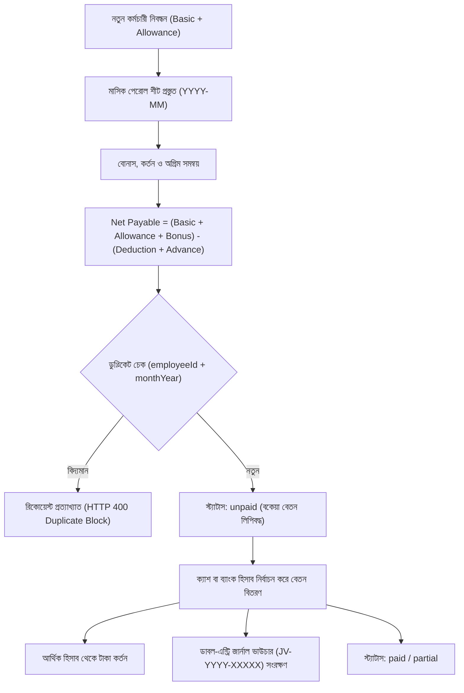

# লুমিনা লাগেজ — কর্মচারী পেরোল ও দ্বৈত দাখিলা হিসাবরক্ষণ আর্কিটেকচার (Phase 9 Documentation)

## ১. ভূমিকা ও উদ্দেশ্য
লুমিনা লাগেজ ও ব্যাগ শপ ম্যানেজমেন্ট সিস্টেমের ফেজ ৯-এ একটি স্বয়ংসম্পূর্ণ, আন্তর্জাতিক হিসাবরক্ষণ মানসম্পন্ন **ডাবল-এন্ট্রি একাউন্টিং (Double-Entry Bookkeeping)**, **কর্মচারী বেতন (Payroll Management)** এবং **ব্যবসায়িক লাভ-ক্ষতি ও ইনভেন্টরি মূল্যায়ন ইঞ্জিন** তৈরি করা হয়েছে। এই মডিউলটি ফিজিক্যাল POS বিক্রয়, ক্রয় চালান, দোকান পরিচালন খরচ এবং অনলাইন অর্ডারের ডাটা একত্রিত করে নির্ভুল লাভ-ক্ষতি ও ব্যালেন্স শীট প্রতিবেদন তৈরি করে।

---

## ২. কর্মচারী ও পেরোল ব্যবস্থাপনা (Payroll Lifecycle)

কর্মচারী নিয়োগ, পদবী, মূল বেতন ও মাসিক বেতন পরিশোধের সম্পূর্ণ জীবনচক্র:

### প্রধান নিরাপত্তা ও গাণিতিক বৈশিষ্ট্য:
1. **জিরো ডুপ্লিকেট পেরোল গ্যারান্টি (Zero Duplicate Payroll Rule):**
   - ডাটাবেসে `{ employeeId: 1, monthYear: 1 }` যৌগিক ইউনিক ইনডেক্স আরোপিত।
   - একই কর্মচারীর জন্য কোনো নির্দিষ্ট মাসে একাধিকবার মূল বেতন এন্ট্রি করার কোনো সুযোগ নেই।
2. **বেতন হিসাব সূত্র:**
   $$\text{Net Payable} = (\text{Basic Salary} + \text{Allowance} + \text{Bonus}) - (\text{Deduction} + \text{Advance Adjusted})$$
3. **আর্থিক হিসাবের সাথে ইন্টিগ্রেশন:**
   - বেতন প্রদানের সময় নির্দিষ্ট একাউন্ট (যেমন: দোকান ক্যাশ ড্রয়ার বা ব্র্যাক ব্যাংক) সিলেক্ট করতে হয়।
   - নির্বাচিত একাউন্টে পর্যাপ্ত ব্যালেন্স না থাকলে ওভারড্রাফট প্রতিরোধ করা হয়।

---

## ৩. ডাবল-এন্ট্রি একাউন্টিং ও চার্ট অফ একাউন্টস (Double-Entry Bookkeeping)

ব্যবসার আর্থিক নির্ভরযোগ্যতা নিশ্চিত করতে প্রতিটি লেনদেনকে ডেবিট এবং ক্রেডিট লাইনে সমানভাবে লিপিবদ্ধ করা হয়।

### চার্ট অফ একাউন্টস হেডসমূহ:
1. **সম্পদ (Assets):**
   - দোকান ক্যাশ ড্রয়ার (`accountType: cash`)
   - ব্যাংক চলতি হিসাব (`accountType: bank`)
   - বিকাশ ও নগদ মার্চেন্ট ওয়ালেট (`accountType: bkash / nagad`)
   - ইনভেন্টরি স্টক মূল্যায়ন (Inventory Asset)
   - কাস্টমারদের বকেয়া (Accounts Receivable)
2. **দায় (Liabilities):**
   - সরবরাহকারীদের বকেয়া (Accounts Payable)
3. **মালিকানাস্বত্ব (Equity):**
   - মালিকের মূলধন (Owner's Capital)
   - অবণ্টিত মুনাফা (Retained Earnings)
4. **রাজস্ব (Revenue):**
   - পিওএস খুচরা বিক্রয় রাজস্ব
   - অনলাইন ই-কমার্স বিক্রয় রাজস্ব
5. **ব্যয় (Expenses):**
   - বিক্রিত পণ্যের খরচ (Cost of Goods Sold - COGS)
   - দোকান ভাড়া, বিদ্যুৎ, ইন্টারনেট ও বিবিধ খরচ (Operating Expenses)
   - কর্মচারী বেতন ও বোনাস (Staff Payroll Expense)

### কঠোর দ্বৈত দাখিলা সমতা নীতি:
$$\sum \text{Debit (Poisha)} = \sum \text{Credit (Poisha)}$$
কোনো জার্নাল এন্ট্রিতে ডেবিট এবং ক্রেডিটের যোগফল সামান্যতম অমিল থাকলে সার্ভার তাৎক্ষণিকভাবে লেনদেন বাতিল (HTTP 400) করে।

---

## ৪. ইনভেন্টরি কস্টিং, COGS ও মুনাফা নির্ধারণ সূত্র

ব্যবসার বাস্তব আর্থিক ফলাফল নির্ণয়ে আন্তর্জাতিক **Weighted Average Cost (WAC)** পদ্ধতি অনুসৃত:

### ১. ওয়েটেড এভারেজ কস্ট (WAC):
$$\text{New WAC} = \frac{(\text{Current Stock} \times \text{Current WAC}) + (\text{Received Qty} \times \text{Purchase Price})}{\text{Current Stock} + \text{Received Qty}}$$

### ২. বিক্রিত পণ্যের ব্যয় (COGS):
$$\text{COGS} = \sum (\text{Sold Variant Quantity} \times \text{Item WAC})$$

### ৩. মোট লাভ / গ্রস প্রফিট (Gross Profit):
$$\text{Gross Profit} = \text{Total Net Sales Revenue} - \text{COGS}$$
$$\text{Gross Margin \%} = \left(\frac{\text{Gross Profit}}{\text{Net Revenue}}\right) \times 100$$

### ৪. নিট পরিচালন মুনাফা (Net Operating Profit):
$$\text{Net Profit} = \text{Gross Profit} - (\text{Operating Expenses} + \text{Staff Payroll})$$
$$\text{Net Margin \%} = \left(\frac{\text{Net Profit}}{\text{Net Revenue}}\right) \times 100$$

### ৫. বর্তমান ইনভেন্টরি মূল্য (Inventory Valuation):
$$\text{Inventory Valuation} = \sum (\text{Variant Current Stock} \times \text{Variant Purchase Cost WAC})$$

---

## ৫. সংশ্লিষ্ট পেজ ও এপিআই এন্ডপয়েন্ট

| পেজ / এপিআই | দায়িত্ব ও কর্মপরিধি |
| :--- | :--- |
| [`/admin/employees`](file:///e:/Business_Project/luggage-shop-management/src/app/(management)/admin/employees/page.tsx) | কর্মচারী তালিকা, নতুন স্টাফ নিবন্ধন ও পদবী ব্যবস্থাপনা |
| [`/admin/payroll`](file:///e:/Business_Project/luggage-shop-management/src/app/(management)/admin/payroll/page.tsx) | মাসিক বেতন হিসাব, বোনাস-কর্তন ও ক্যাশ/ব্যাংক থেকে বিতরণ |
| [`/admin/accounts`](file:///e:/Business_Project/luggage-shop-management/src/app/(management)/admin/accounts/page.tsx) | ক্যাশ, ব্যাংক, বিকাশ, নগদ ব্যালেন্স ও ফান্ড ট্রান্সফার |
| [`/admin/reports`](file:///e:/Business_Project/luggage-shop-management/src/app/(management)/admin/reports/page.tsx) | লাভ-ক্ষতি বিবরণী (P&L), বিক্রয়, COGS ও ইনভেন্টরি অডিট |
| `/api/admin/reports/summary` | ব্যবসার মূল কেপিআই মেট্রিক্স এপিআই |
| `/api/admin/reports/profit-loss` | বিস্তারিত ইনকাম স্টেটমেন্ট (P&L) এপিআই |
| `/api/admin/accounts/transfer` | ব্যাংক/ক্যাশ তহবিল স্থানান্তর ও ডাবল-এন্ট্রি এপিআই |

---
*ডকুমেন্টেশন প্রস্তুতকারক: প্রিন্সিপাল সফটওয়্যার আর্কিটেক্ট ও সিনিয়র ফিনান্সিয়াল ইঞ্জিনিয়ারিং টিম।*

